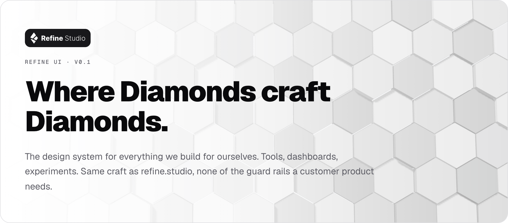

<picture>
  <source media="(prefers-color-scheme: dark)" srcset=".github/assets/banner-dark.png" />
  
</picture>

# 💎 Refine UI

Refine UI is the design system the Diamonds use to build internal tools: time trackers, voting bots, dashboards, admin panels, and the experiment you start on a Friday. It takes its look from [refine.studio](https://refine.studio), so every tool we build looks like it came from us.

**📖 Storybook:** [ui.refine.studio](https://ui.refine.studio). Sign in with a GitHub account in the `refine-studio` organisation to open it.

## 🎯 Why it exists

Refine UI is built for us first, so it is free to experiment. It has one brand and its own voice: the refine teal, heavy display type, gradients, glass, soft shadows, the hex field and the diamond mark. You get a solid set of everyday parts, so you can spend your time on the idea and not on another button.

## 📦 What is inside

| Area        | Holds                                                                                            |
| ----------- | ------------------------------------------------------------------------------------------------ |
| Foundations | Principles, logo, colour, type, shape and spacing, elevation, motion, light and dark mode, icons |
| Components  | About 45 building blocks: buttons, forms, dialogs, menus, tables, tabs, toasts and more          |
| Widgets     | Composed pieces such as App Shell, Command Menu and Page Header, plus full example screens       |
| Icons       | The 467 Refine icons, drawn in the shared refine-icons package                                   |

**Stack:** React 19 · Tailwind CSS 4 · Radix UI · class-variance-authority · @refine-studio/refine-icons · Geist Sans and Geist Mono

## 🚀 Install it in another repo

Refine UI is published to the public npm registry as [`@refine-studio/ui`](https://www.npmjs.com/package/@refine-studio/ui). The install needs no token and no `.npmrc`, and the version arrives already built.

### 1. Install the package

```sh
pnpm add @refine-studio/ui
```

Your app needs React 19 and Tailwind CSS 4.

### 2. Import the styles

Import the stylesheet after Tailwind in your global stylesheet. It brings the tokens, the Geist fonts and the animations. It also registers the library's components as a Tailwind source, so you need no extra `@source` line.

```css
@import 'tailwindcss';
@import '@refine-studio/ui/styles.css';
```

### 3. Wrap the app and build

`ThemeProvider` sets light or dark mode on `<html>` and remembers the choice.

```tsx
import { Button, ThemeProvider } from '@refine-studio/ui';

export const App = () => {
  return (
    <ThemeProvider mode="system">
      <Button variant="gem">Ship it</Button>
    </ThemeProvider>
  );
};
```

### 🔤 Fonts in a build of your own

The stylesheet loads Geist and Geist Mono from `./fonts/`, next to itself. A bundler such as Vite resolves them for you. When your build writes the CSS out by hand, copy one folder next to it:

```sh
cp -R node_modules/@refine-studio/ui/dist/fonts <your-css-folder>/fonts
```

The folder holds the `.woff2` files and their licences (SIL Open Font License).

## Theming in one breath

There is one brand: refine.studio's teal, zinc neutrals and the website's radii. Two knobs remain, and you can set each on `<html>` or on any subtree.

| Knob    | Values                                              |
| ------- | --------------------------------------------------- |
| Mode    | `.light`, `.dark`, `.on-gem`                        |
| Density | `data-density="compact \| comfortable \| spacious"` |

`ThemeProvider` and `useTheme` manage the document theme, `ThemeSwitcher` gives people a light/dark/system toggle, and `ThemeScope` re-themes a single subtree.

## Develop

```sh
pnpm install
pnpm dev              # Storybook on http://localhost:6006
pnpm test             # Vitest
pnpm typecheck && pnpm lint
pnpm build            # library → dist/
pnpm build-storybook  # static Storybook → storybook-static/
```

Every component lives in `src/components/<name>/` next to its stories. The tokens live in `src/styles/refine-ui.css`. When you add a custom utility or token, also register it in `src/lib/cn.ts` so `tailwind-merge` resolves conflicts with it.

## Release

1. Bump `version` in `package.json`.
2. Tag the commit with `vX.Y.Z` and push the tag.

The `Release` workflow publishes that version to npm with provenance and creates a GitHub release. It publishes through npm's trusted publishing, so no npm token exists anywhere. The tag must match `version`, or the workflow stops. Pushing to `main` redeploys Storybook to [ui.refine.studio](https://ui.refine.studio) through GitHub Pages.
